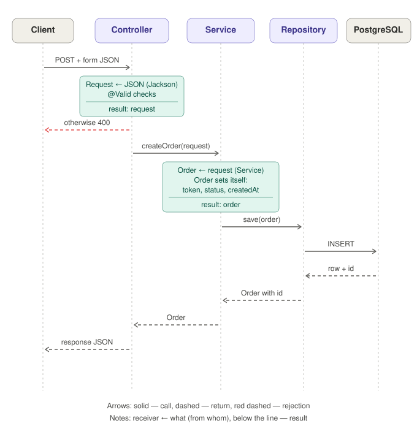
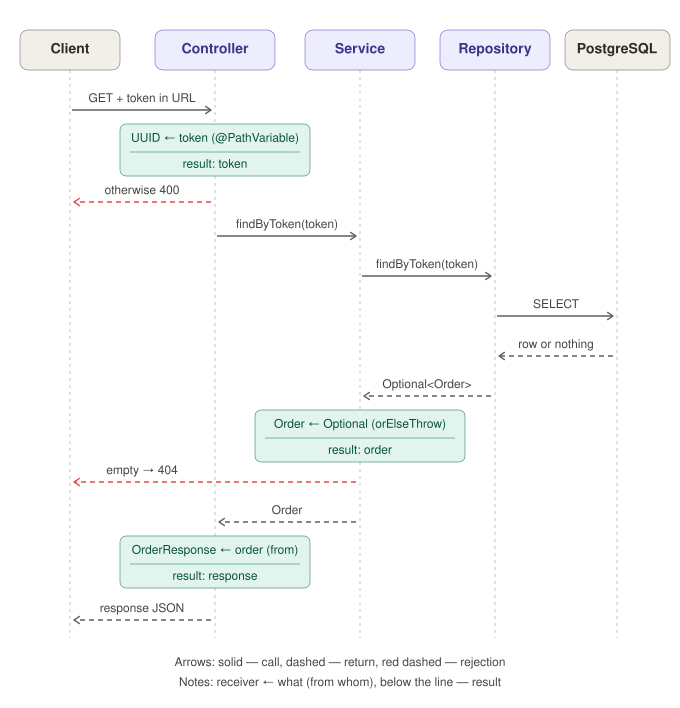

<p align="center">
  <picture>
    <source media="(prefers-color-scheme: dark)" srcset="docs/assets/nozzle-logo-dark.svg">
    
  </picture>
</p>

# Nozzle

A platform that connects people who need something 3D-printed with people who own 3D printers. A client uploads a model, picks material and colour, and places an order; the platform offers it to a suitable printer owner nearby, taxi-style, and holds the payment until the print is delivered.

> **Status:** learning project in early development. I'm building it to learn Spring Boot, so the design is documented in more detail than the code is written.

## What works now

- `POST /api/orders` — create an order with request validation; the server sets the private token, status and creation time itself
- `GET /api/orders/{token}` — get an order by its private token (returns only client-facing fields, `404` if not found)
- Orders are stored in PostgreSQL, with constraints at the database level as well

## How it works

<p align="center">
  
  &nbsp;
  
</p>
<p align="center">
  <sub>Left: create order — <code>POST /api/orders</code> · Right: get order by token — <code>GET /api/orders/{token}</code></sub>
</p>

## Tech stack

- Java, Spring Boot (Web, Data JPA, Validation)
- PostgreSQL
- Maven
- Docker Compose for the local database

## Running locally

Requirements: JDK, Docker.

```sh
git clone git@github.com:kzbj/nozzle-print.git
cd nozzle-print
docker compose up -d        # starts PostgreSQL
./mvnw spring-boot:run      # starts the app
```

Example requests are in [`requests.http`](requests.http).

## Documentation

- [Requirements](docs/requirements.md) — how the system should work: order lifecycle, dispatch, payment, delivery, moderation, and ideas deliberately left for later
- Design decisions (`docs/decisions/`) — coming soon: why each rule was chosen and what alternatives were considered

## Design

<p align="center">
  
  &nbsp;
  
</p>
