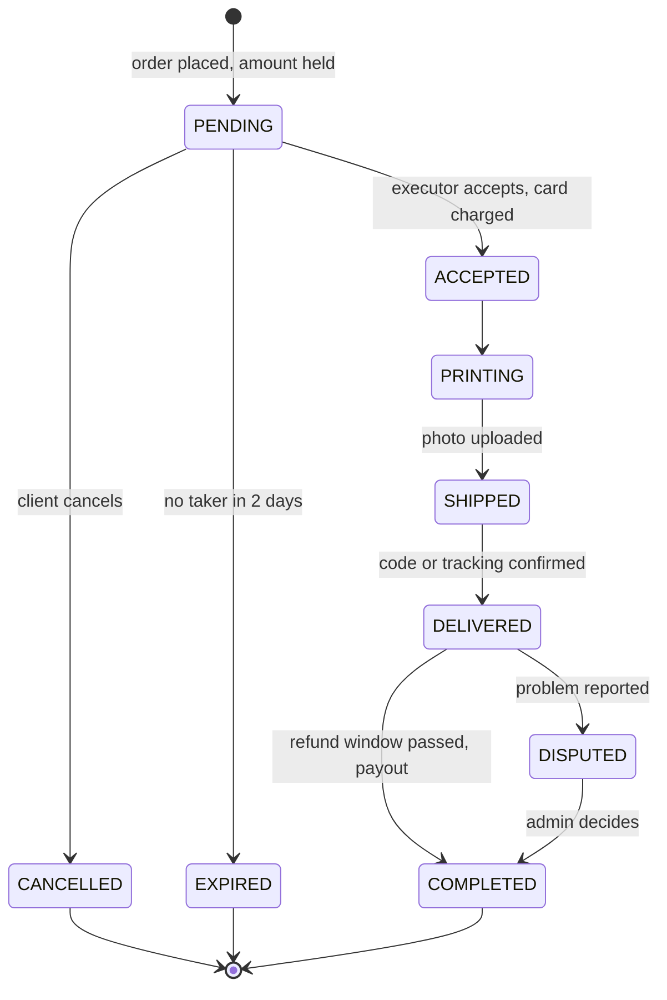

# Nozzle – Requirements

**Status:** learning project in early development. This document describes how the system *should* work; the decisions behind each rule are recorded separately in `docs/decisions/`.

## Overview

Nozzle is a platform that connects people who need something 3D-printed with people who own 3D printers. A client uploads a model, picks material and colour, and places an order. The platform offers the order to a suitable printer owner nearby, taxi-style: one executor at a time, with a short time limit to accept. The platform holds the payment until the work is done and delivered.

Scope of the first version: Czechia, one order printed by one executor, printers registered in the system but operated manually by their owners.

## Market context

This model has been tried before at scale, and the design takes its lessons into account.

**3D Hubs** (Amsterdam, 2013) started as a peer-to-peer marketplace connecting people who needed prints with local printer owners. It grew to more than 22,000 hubs by 2015, yet in 2018 it closed the open peer-to-peer network and moved to vetted professional manufacturing partners only. Reasons it gave publicly:

- professional customers, who order most, were hesitant because there was no guarantee of quality and delivery time;
- maintaining the peer-to-peer platform alongside a professional service created too much technical complexity.

**Existing platforms** such as Craftcloud and Treatstock already connect customers with print providers. Craftcloud gets most of its customers through its sister magazine All3DP, which shows that the hard part of a marketplace is attracting customers, not the software.

**What this means for Nozzle:**

- Quality and delivery reliability are the core problem, which is why the design includes executor responsibility for quality, photo proof, delivery confirmation, a refund window and recent-order ratings.
- A two-sided marketplace needs both clients and executors at the same time. A realistic first step to test demand would be a single executor (the author) before opening the platform to others.
- A possible niche is local and fast: Prague, Czech language, students and makers.
- Nozzle is primarily a learning project; this section is here to show the design is aware of these risks, not to claim a business case.

## Actors

| Actor | What they do |
| --- | --- |
| **Client** | Uploads one or more 3D models, chooses material, colour and delivery, places the order, tracks its status, confirms delivery, can open a dispute. Does not choose the executor. |
| **Executor** | Registers their printers, sets which materials, colours and delivery methods they offer, goes online to receive offers, accepts or declines orders, prints, ships. Responsible for print quality. |
| **Platform (admin)** | Calculates prices, dispatches orders, holds payments, pays executors, reviews disputes and reported orders. |

## Order lifecycle

The client's money is only held while the platform looks for an executor; it is charged when someone accepts the order and reaches the executor only after the refund window has passed.

| Status | Meaning | Who moves it on |
| --- | --- | --- |
| `PENDING` | Order placed, amount held on the client's card, platform is looking for an executor. Lasts up to 2 days. | Platform (dispatch) |
| `CANCELLED` | Client cancelled while the order was still pending. The hold is released. | Client |
| `EXPIRED` | Nobody accepted within 2 days. The hold is released. The client is warned about this limit when ordering. | Platform (timer) |
| `ACCEPTED` | An executor took the order; the held amount is charged. | Executor |
| `PRINTING` | Executor started printing; that printer is now busy. | Executor |
| `SHIPPED` | Part handed over for delivery; executor uploads a photo of the finished print. | Executor |
| `DELIVERED` | Delivery confirmed by a code the client gives at handover (self-delivery) or by the tracking number (post/courier). The refund window starts. | Client / carrier |
| `DISPUTED` | Client reported a problem within the refund window. | Admin decides: reprint, refund or payout |
| `COMPLETED` | Refund window passed without a dispute; money is paid out to the executor. | Platform (timer) |

## Executors and printers

- An executor registers each of their printers in their profile, with the materials and colours it can print.
- Printers are **registered only**: the platform does not control them over the network. The executor starts every print manually.
- Each printer has a status: `FREE` or `BUSY`.
- **One printer = one active order.** An executor with three printers can work on three orders at once.
- **One order = one executor.** A client may upload several files in one order (e.g. a case, a lid and legs); all of them are printed by the same executor, so the parts match in tolerance and colour.
- An executor only accepts orders they have enough material for. The platform cannot verify stock, so this relies on trust and the rating.

## Dispatch

Orders are dispatched taxi-style, one executor at a time:

1. The executor switches themselves **online** ("accepting orders") in the web app. Only online executors receive offers.
2. A new order is offered to **one** suitable executor: online, with a free printer that supports the material and colour, and a delivery method that covers the client's address. Among those, the nearest one is chosen first.
3. The executor gets a **notification** and has **30 seconds** to read the order (material, colour, model, destination) and accept or decline it.
4. If they decline or don't answer, the order is offered to the next suitable executor.
5. The search continues for up to 2 days; executors who come online later can still receive the offer. After that the order becomes `EXPIRED`.

**Accepting must be atomic.** If an executor presses "Accept" at the same moment the offer times out and moves to the next person, the order must still end up with exactly one executor. The check "this offer is still mine and has not expired" and the write "the order is mine" happen as one operation in the database.

**Timers are stored, not running.** Each offer stores its expiry time (`expires_at`) in the database; a scheduled job moves expired offers on. This survives a server restart.

**Notifications** go through a `NotificationSender` interface, so the channel can change without touching the order logic. First implementation: to be decided (Telegram bot or Web Push).

## Pricing

- The **platform calculates the price** before the order is placed. The client pays before any executor is found, so executors cannot set their own prices.
- The price is based on the amount of material, estimated print time, the material type and the delivery method.
- First version: a rough estimate from the model's volume. Later: an exact estimate from a slicer (e.g. PrusaSlicer's command-line mode).
- The executor sees in the offer how much they will earn and decides whether to accept.

## Payment

The platform acts as an intermediary (escrow): money goes client → platform → executor.

1. **When the order is placed**, the amount is **held** on the client's card (authorised, not charged).
2. **When an executor accepts**, the held amount is **charged**. The client does not need to confirm anything again.
3. **If the order is cancelled or expires**, the hold is released; nothing is charged and nothing needs to be refunded.
4. **After delivery** a refund window starts. If the client raises no dispute, the money is **paid out to the executor** when the window ends.

The client is told upfront that the money goes to the platform, not directly to the executor, and is released only when the order is fulfilled.

The executor never starts printing before the order is `ACCEPTED`, so they never print for free.

In the first version payment is simulated. A real provider (e.g. Stripe Connect) comes later; platforms that hold other people's money are regulated in the EU, which such providers handle.

## Delivery

The executor chooses which delivery methods they offer. The client pays for delivery.

| Method | Coverage |
| --- | --- |
| Self-delivery, local | The executor's city and nearby area (e.g. Prague and its outskirts) |
| Self-delivery, national | Anywhere in Czechia, for executors who travel by car |
| Parcel box (e.g. Z-BOX) | Czechia |
| Courier | Czechia and other countries; the only option for orders abroad |

- Self-delivery is limited to Czechia.
- The client's address acts as a **dispatch filter**: an order is only offered to executors whose delivery methods cover that address.
- Each method has an estimated delivery time (configurable), shown to the client when ordering.
- **Proof of delivery:** for self-delivery, the client gives the executor a code at handover; for parcel boxes and couriers, the tracking number is used. Delivery confirmation starts the refund window.

## Quality and disputes

- The **executor is responsible for print quality** and bears the cost of failed prints.
- Before shipping, the executor uploads a **photo** of the finished part.
- The client can report a problem **within the refund window**, with a photo. The executor may reprint or refund; if they disagree, the admin decides.
- If the client stays silent, the order completes automatically when the window ends, so payment cannot be held back indefinitely.
- There is no client–executor chat. Contact details are not shared; the client does not see who the executor is.

## Ratings

- The client doesn't choose the executor, so ratings serve the **platform**: deciding who gets offers first and spotting executors who should be warned or removed.
- Instead of a 1–5 star score, the client answers two or three concrete questions (e.g. "Did the quality match your expectations?", "Did it arrive on time?"), plus an optional comment.
- Only the **most recent orders** count, so old mistakes and old successes fade out.

## Prohibited orders and moderation

- Orders must not break Czech or EU law, on either side. Examples: weapons and weapon parts, counterfeit goods, models infringing someone else's trademark.
- Both clients and executors accept a **list of prohibited items** in the terms of service.
- The executor can **decline any order**, including as "suspicious / prohibited".
- A **report** button freezes an order and sends it to the admin for manual review.
- Simple automatic checks on the order title and description (keywords). Recognising a prohibited part from the 3D file itself is not reliable, so the main safeguard is people: executors and admin moderation.

## Configurable parameters

These values live in configuration, not in code, and will be tuned once real orders exist.

| Parameter | Starting value |
| --- | --- |
| Time for an executor to answer an offer | 30 seconds |
| Time to find an executor before the order expires | 2 days |
| Refund window after delivery | to be decided |
| Estimated delivery time per method | to be decided |

## Open questions

- Exact pricing formula.
- Length of the refund window.
- First notification channel: Telegram bot or Web Push.
- What the client sees when an order expires, and whether to offer a retry.
- Whether an executor can decline with a reason (e.g. "model is unprintable") without affecting their rating.

## Future ideas

Considered and deliberately left out of the first version:

- **Splitting one order across several executors** (e.g. a case and its legs printed by different people). Risks: parts not fitting due to different printers and tolerances, colour mismatch between filament brands, several deliveries, and partial failure when one part finds no executor.
- Recommending which printer to load to finish faster.
- Remote printer control (OctoPrint / PrusaLink).
- Real-time chat between client and executor.
- Rating clients, e.g. to protect executors from unfair refund claims.
- Precise delivery-time estimates from travel times (e.g. a maps API), instead of a fixed estimate per method.
- Web Push in addition to the first notification channel.
